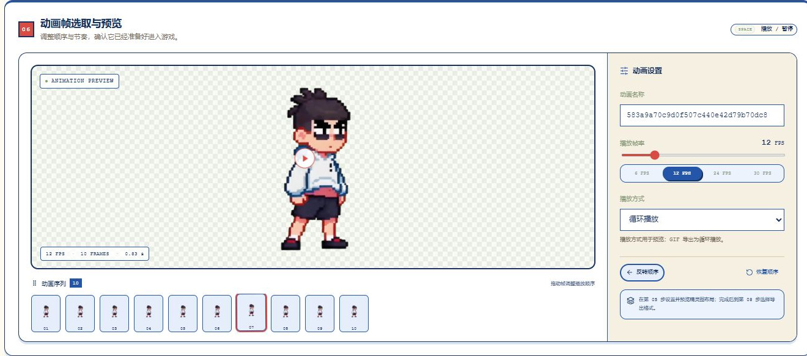
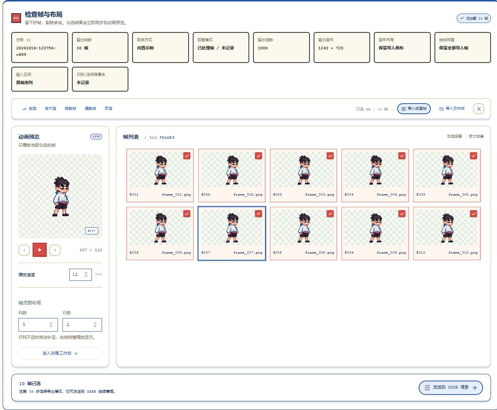
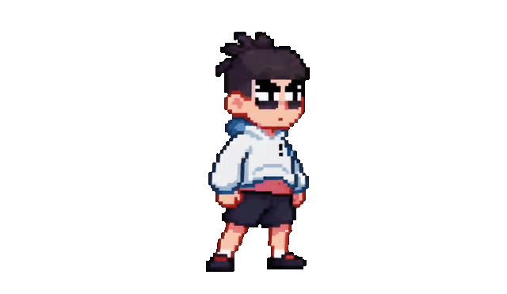

# 帧间 Framecraft

本地视频与动画素材工作台：七步完成导入截取、抽帧设置、检查布局、精细抠图、动画预览、Real-ESRGAN 平滑与精度压缩。



## 安装与启动

首次克隆后，在 Windows 的项目根目录打开 PowerShell。安装前需要 Node.js 22.12 及以上的 22.x 或 24.x、Git，以及 Python 3.10–3.13。透明 MOV 导出和使用视频素材的浏览器测试还需要 FFmpeg 与 FFprobe，并将两者加入 PATH；其他功能不需要这项可选依赖。

先安装依赖，再启动工作台：

```powershell
.\setup.ps1                    # NVIDIA CUDA 12.8
# .\setup.ps1 -Device cpu      # 使用 CPU 时改运行此命令
.\start.ps1
```

也可为 `setup.ps1` 传入 `-PythonPath` 指定 Python 可执行文件。安装完成后，后续可直接双击 `start.bat`，或运行 `.\start.ps1`。

打开 [本地工作台](http://127.0.0.1:8765)。网页与 AI 接口由同一个本地服务提供。默认只绑定本机地址，不接受局域网连接。服务日志位于 `logs/`。

所有 Python 环境、模型、临时文件与缓存都位于本项目目录。CUDA 运行库体积较大；不需要另外安装完整 CUDA 开发工具包。

## 工作流

帧按 01 → 02 → 03 → 04 → 05 → 06 → 07 依次传递：检查区保留抽帧原图，动画预览使用抠图结果，平滑结果继续传入压缩。修改抠图参数、重新抽帧或新增未处理帧后，后续步骤等待当前结果，避免导出旧帧；关闭某项处理时原样传递其输入。

1. 点击顶部导入按钮选择文件，或把视频、图片拖到顶部导入按钮区域（作为新项目，必须填写项目名），也可在工作台按 Ctrl+V 粘贴截图或已复制的媒体文件。导入视频后自动弹出命名窗口，输入当前动画片段名并按回车确认；普通序列、精灵图与精度压缩的 ZIP 均使用此名称，之后也可在“动画设置”修改。多张图片按文件名顺序导入为动画帧，01 区显示动画预览与帧列表，支持拖动排序；向 01 区帧列表批量拖入图片会追加到当前项目末尾，保留项目名和已有帧顺序。其他页面区域不接收文件；帧卡片不使用悬浮、点击或播放脉冲动效；编辑文字时保留正常粘贴。视频帧率默认 30 FPS，可根据原视频手动校准；选择起止帧后循环预览。
2. 选择采样间隔、输出高度、画布布局与边距，点击“开始抽帧并检查”。这一步只采样与设置画布，不执行抠图。
3. 查看任务属性并勾选保留的帧；支持全选、奇数、偶数、反选；可导入图片序列或文件夹。01、03、05 三处帧列表共享顺序，拖动任一列表中的帧会同步到其他列表和导出。左侧显示动画预览，下方手动输入精灵图的列数与行数；右侧帧列表按同一布局等比缩放，完整显示在面板内，无需滚动。保留棋盘格、勾选、单帧检查与播放高亮；行列不足时自动补足，手动留出的空格会保留到工程和精灵图导出。
4. 从五种抠图引擎中选择，按需启用角落去水印和四项独立后处理，预览当前帧，再点击“应用抠图并继续”，只处理第 03 步保留的帧；结果自动传入第 05 步，并保持已有画布尺寸。图片序列按当前勾选和排列顺序处理；原始导入帧会独立保存，重复抽帧不会累积缩放或继续丢帧。
5. 拖动动画序列调整顺序，选择播放帧率、循环/往返/单次模式；空格播放暂停，左右键逐帧。
6. 可选 Real-ESRGAN 平滑：当前已选帧先放大 4 倍、缩回原尺寸。透明帧保留原 Alpha 与轮廓；全不透明帧按当前设置抠图。完成后，后续导出和压缩使用平滑结果。
7. 在“动画帧精度压缩”中选择硬或软缩放，调整输出比例、透明像素清理、锐化与调色板量化，点击原始帧或压缩帧下方的“导出”，展开 Frames、Sprite Sheet、透明 MOV、GIF 四种模式。





上面的 GIF 由内置示例的 10 帧生成，播放帧率为 12 FPS，展示宽度为 640 像素。GIF 只支持二值透明，无法保留 PNG 的半透明边缘。

内置示例固定保存在 `public/built-in-example/`，包含动画帧、顺序、选中状态、名称与帧率。每次打开或刷新页面都会载入同一份内置示例。

后续导入、抽帧、压缩或 XSXB 回传的内容只用于当前工作，不会替换内置示例，也不会在刷新时自动恢复为示例。点击“清空帧列表”仅清空当前列表；刷新后仍会载入固定示例。抠图参数偏好继续保存在本机浏览器。

## 帧动画项目列表

页面顶部可以选择或输入工程目录，自动识别该目录下保存的帧动画项目。默认目录为相对于网页项目根目录的 `FrameAnimProjectList`；移动整个网页项目后，相对路径仍有效。也支持其他相对路径或绝对路径，选过的目录会在本机浏览器中记住。

编辑完成后，在页面末尾点击“添加到帧动画项目列表”。保存内容包括原始视频或图片、全部帧的顺序与勾选状态、片段名、播放帧率、截取区间、抠图与后处理及导出参数，以及精细抠图、平滑和精度压缩的结果与设置。任务 ID、取样方式、抠图模式、输出倍数、画布布局、抽帧间隔、输入区间和背景色等任务属性也一并保存。每次添加都会创建独立工程，不覆盖先前保存的工程。

下次打开页面，在顶部读取同一目录并点击“打开项目”即可继续编辑。工程是包含 `project.json` 和素材的 `.framecraft` 文件夹；复制整个工程文件夹到其他工程目录后也能自动识别，不依赖浏览器缓存。未保存的临时操作不会在刷新后自动恢复。

首尾帧修正步骤已移除。旧工程的修正设置和修正帧不再参与工作台预览与导出；若已保存的平滑结果包含首尾修正，打开时会停用该结果并恢复原始帧，需要时可重新运行平滑。独立保存的压缩副本继续保留。

项目卡片上的“删除项目”会先弹窗确认，确认后从列表移除，工程备份保留在该目录的 `.trash` 回收文件夹。为兼容 Windows 目录权限，原目录会标记为已删除，不再出现在列表中。当前已经打开的动画仍可继续编辑、另存为新项目。

## 截取区间

起始帧和结束帧下方均有“使用当前帧”：先在左侧预览进度条定位画面，再点击相应按钮设定边界。播放中点击会先暂停并固定当前画面。截取区间由手动设置，不会自动调整首尾。

## Real-ESRGAN 平滑

第 06 步接入 [Real-ESRGAN 官方提供的 NCNN/Vulkan 便携版](https://github.com/xinntao/Real-ESRGAN#portable-executable-files-ncnn)，使用 `realesrgan-x4plus-anime` 模型。输入为当前已选帧。点击“准备平滑模型”后，服务优先复用本机 `sprite-video-lab/work/tools/` 中的官方组件，缺少时从官方 Release 获取程序与模型，保存在 `backend/runtime/realesrgan/`。需要可用的显卡 Vulkan 驱动；平滑运行时独立于抠图引擎的 CUDA/CPU 设备选择。

启用后点击“开始平滑”，实际执行 **Real-ESRGAN ×4 → 缩回原尺寸**。已经包含透明像素的帧仅增强 RGB，完整保留原 Alpha，不重复抠图、腐蚀或边缘后处理，保持透明轮廓。全不透明帧才按当前设置抠图。最终保持帧数、顺序和画布尺寸，不重复添加画布边距。面板就绪行会显示当前使用的官方 NCNN 模型名称与倍率。

面板提供进度、取消和同步前后预览。完成后，PNG、精灵图、GIF、XSXB 和第 07 步压缩均使用有效的平滑结果；关闭平滑可恢复使用上一步的帧。改变输入帧或处理参数后需重新处理；开启但尚无有效结果时，后续导出和压缩会等待。工程会保存已完成的平滑帧，同一算法版本下重新打开无需重跑。旧版工程中的平滑结果需重新处理，以修正透明边缘。

## 动画帧精度压缩

第 07 步默认自动载入当前勾选的有效帧（包含已启用的平滑结果），前面的勾选、排序、处理结果和播放帧率变化后会自动同步，无需点击“使用已选帧”。也可独立导入图片序列或文件夹；本地导入后保留独立输入，点击“使用已选帧”即可恢复跟随工作台。设置参数后点击“生成对比”，输入动画与压缩后动画同步播放，支持逐帧检查、缩放和平移。

- **硬缩放 · 最近邻**：选择实际源像素，保留硬像素边界。
- **软缩放 · Lanczos**：在本地 Python 服务中使用 Lanczos 重采样，并处理预乘 Alpha，减少透明边缘的颜色污染。
- **PNG 编码**：独立选择保真 PNG 或调色板量化；两者均可搭配硬、软任一种缩放。调色板量化生成指定颜色上限的索引 PNG，会改变颜色与半透明层次，可通过同步预览检查结果。

输出倍率、透明清理阈值、缩小后锐化和最大颜色数可独立调整；最大颜色数只用于减色模式。处理始终保留输入帧数、顺序和播放帧率，不通过丢帧降低体积。

体积与节省比例由真实的输入、输出帧文件字节数计算，不包含 ZIP 封装。不同素材的收益不同，输出更大时会如实显示增加。PNG 序列 ZIP 会保留生成后的 PNG 字节并附带帧率与处理参数清单；精灵图 ZIP 按第 03 步的布局生成同名精灵图，并包含 `atlas.json` 与 `manifest.json`。

修改参数后需要重新生成对比；取消或失败会保留当前输入的上一次完整结果。跟随工作台时，前面的输入帧变化会清除过期对比，避免导出旧结果；独立导入的本地帧与对比不受前面操作影响。工程会保存输入来源模式，重新打开后继续使用相同方式。

## XSXB 帧调参标签页

顶部的“XSXB 帧调参”标签页接入 [XSXB Frame Tuner](https://github.com/sparklecatta-lang/XSXB-Frame-Tuner) 官方 Lite 编辑器，服务首次打开时自动启动在本机 `127.0.0.1:5188`，无需额外安装 Node 依赖。

在“检查帧与布局”中勾选素材后，点击“发送到 XSXB 调参”，即可将当前顺序、帧率和动画名称一并导入。进入后可使用上游原有的角色/动作/单帧变换、碰撞框、帧时长、图片图层、音效、攻击拖尾及透明素材导出功能。

每次发送创建一个独立的 Lite 调参项目，不覆盖已有项目。切换本工具的标签页会保留编辑器状态；多个发送会保留各自的编辑会话。在 XSXB 中点击“保存精调结果返回 05 动画帧选取与预览”，会先保存调参，再把渲染后的 PNG 序列带回工作台并跳到第 05 步。刷新整个 Framecraft 网页仍会丢失浏览器内尚未保存的改动。

Lite 使用独立的素材数据，不绑定或改写 Godot/Unity 游戏项目。项目数据保存在 `backend/vendor/XSXB-Frame-Tuner/data/lite/` 与 `workspace/lite/`，上传暂存位于 `backend/tuner-data/`。升级时保留这些目录。需要绑定实际游戏项目时，可另外使用上游完整版。

集成包含两处本地兼容修正：创建新项目不会因为共享预设的迁移标记而阻止旧项目保存；Lite 预览会自动适配当前帧的尺寸，避免角色头部超出视图。补丁只接受已固定的源码版本，保留实际数据变更的保存冲突检查，不改变导出素材的变换参数。

画布移动与缩放、锚点导入及精调结果回传等本地集成改动也随仓库保存。[源码差异](backend/patches/xsxb-local.patch) 可直接审阅；同目录的源码包和 SHA-256 清单供安装脚本离线重放这六个相关文件。新克隆运行 `setup.ps1` 即可恢复这些功能；重复执行不会覆盖未知源码编辑或本地工程数据。

## 五种抠图引擎

- **纯色抠图**：浏览器 Canvas 色度键，适合绿幕、蓝幕及其他纯色背景，无需模型。
- **Luma 亮度抠图**：浏览器按亮度生成 Alpha，适合黑底光效或白底素材，无需模型。可自动依据背景取色判断，或手动选择抠除黑底、白底，并调整黑场、白场、Gamma 与强度。
- **BiRefNet**：官方模型主体分割，提供通用版、HR-matting 和 Lite。输出学习得到的 Alpha，不会在失败时静默替换成色度键。
- **CorridorKey**：官方 GreenFormer 推理引擎，使用纯色粗蒙版作为 Alpha Hint，适合绿幕素材；输出正确转换到 sRGB 的直通 Alpha PNG。
- **BiRefNet + CorridorKey**：先用 BiRefNet 生成 Alpha Hint，再用 CorridorKey 估计细节与前景颜色。两个模型分阶段移出显存，减小显存峰值。

在 AI 面板选择设备、推理分辨率和模型，再点击“加载 / 下载模型”。首次需要联网从官方仓库下载模型，之后使用本地缓存。AI 预览通过按钮手动触发，避免每次拖动滑块重复执行推理。模型参数只影响之后的预览和批量处理，已经生成的帧需重新处理才会更新。

RTX 3070 8GB 建议先用 512 或 768 分辨率、自动/CUDA 设备。2048 的显存需求更高；显存不足会明确报告，不会自动降质。CPU 也可推理，速度明显更慢。

色度键与 Luma 在浏览器执行；AI 抠图和平滑仅把帧发送到本机服务，不向第三方上传素材。模型下载会访问官方 GitHub/Hugging Face。刷新会载入固定内置示例；保存过的工程可从项目列表重新打开，处理参数偏好保存在浏览器本地。

## 去水印与独立后处理

第 04 步的“去水印”按参考区域自动检测左上或右下角，并将识别到的角落区域清为透明。它使用区域透明移除，不补绘被遮挡的画面；主体进入角落时应结合预览判断是否启用。

四项后处理可独立勾选，也可组合：**背景残留转黑、背景残留饱和度归零、半透明像素转黑、半透明像素转不透明**。背景残留操作只处理透明边缘附近与背景色相符的残色；半透明操作处理仍可见的半透明像素。完全透明像素始终保持透明；同时选择残留转黑与去饱和度时，转黑优先。修改后需重新预览或批量处理，已经生成的帧不会随参数自动改写。

## 导出

导出入口统一位于第 07 步“动画帧精度压缩”。在原始帧或压缩帧预览下点击“导出”，下方展开四个模式，再次点击可收起。原始侧导出当前载入的未缩放帧，未独立载入时使用工作台已选帧；压缩侧导出实际生成的结果。

- **Frames**：PNG 序列 ZIP，保留 PNG 原字节，附带帧率、来源信息和处理参数。
- **Sprite Sheet**：按第 03 步“精灵图布局”排列的同名精灵图，以及 `atlas.json`、`manifest.json` ZIP；预览与导出使用相同排列规则。
- **透明 MOV**：本机 FFmpeg 生成 QuickTime Animation（qtrle / argb）视频，保留连续透明度、帧数和播放帧率。
- **GIF**：循环动画，GIF 格式只支持二值透明，不支持 PNG 的半透明边缘。

预览底色只帮助检查透明效果，不会写入导出文件。预览播放方式只控制界面；GIF 导出为循环动画。导出的 JSON 是通用元数据，Godot/Unity 中需要按图集坐标配置动画。

单次最多 400 帧，累计输出上限 1.2 亿像素；精灵图单边最多 16384 像素，总计最多 6400 万像素。长视频建议分段处理。

## 开发与验证

后端默认运行于 `127.0.0.1:8765`，Vite 开发服务运行于 `127.0.0.1:5173` 并将 `/api` 请求代理至后端；XSXB Lite 使用 `127.0.0.1:5188`。开发时在两个终端分别启动前后端。浏览器测试前需启动对应服务：多数脚本使用开发地址 `5173`，`tuner-return-browser.mjs` 使用 `8765`；部分脚本支持通过 `FRAMECRAFT_URL` 覆盖地址，具体见脚本。

浏览器测试默认使用本机已安装的 Microsoft Edge。需要使用其他 Chromium 浏览器时，可设置 `FRAMECRAFT_BROWSER_EXECUTABLE_PATH` 为浏览器可执行文件路径。

```powershell
npm run dev               # http://127.0.0.1:5173；/api 代理到 8765
.\.venv\Scripts\python.exe -m backend.app
npm run build
npm test
.\.venv\Scripts\python.exe -m pytest backend/tests -q
node tests/browser.mjs    # 本机 Edge + ffmpeg 的真实端到端验证
node tests/compression-browser.mjs  # 压缩预览、下载与回传验证
node tests/loop-browser.mjs  # 七步流程、旧工程兼容与原始首尾导出验证
```

`src/lib/media.ts` 负责浏览器读取与采样，`ai.ts` 调用本地模型，`export.ts` 负责素材导出。Python 接口为 `GET /api/health`、`POST /api/models/prepare`、`POST /api/matte`。

第 03 步的帧列表由 `SheetLayoutControls.tsx` 输入行列，`FittedFrameGrid.tsx` 根据面板宽高缩放完整网格，保留帧选择、播放高亮和单帧检查。`src/lib/sheetLayout.ts` 统一工程与导出的布局规则。`ExportModes.tsx` 与 `src/lib/previewExport.ts` 提供第 07 步两张预览卡的统一导出模式；`backend/exports.py` 的 `POST /api/exports/mov` 使用本机 PATH 中的 FFmpeg、FFprobe 编码并验证透明 MOV。

`SmoothingPanel.tsx` 与 `src/lib/smoothing.ts` 负责第 06 步的模型准备、透明帧保留 Alpha、不透明帧抠图、前后预览与项目恢复；`backend/smoothing.py` 提供 `GET /api/smoothing/status`、`POST /api/smoothing/prepare` 和 `POST /api/smoothing/frame`。

`CompressionPanel.tsx` 与 `src/lib/compression.ts` 负责第 07 步的源帧快照、同步预览和批量处理，`backend/compression.py` 提供 `POST /api/compression/frame`；`resize_mode` 独立选择硬、软重采样，`algorithm` 控制 PNG 编码并兼容旧工程。`src/lib/compressionExport.ts` 导出保持 PNG 原字节的 PNG 序列 ZIP 和精灵图 ZIP。

上游来源、固定版本与许可见 [THIRD_PARTY.md](THIRD_PARTY.md) 和 `backend/vendor-sources.json`。

## 仓库内容与本地数据

仓库保留源码、依赖锁文件、内置示例及 `docs/images/` 中的截图与演示 GIF。`.gitignore` 排除已安装的依赖、模型权重、第三方 vendor、运行时组件、本地工程、`.env`、日志、缓存和测试报告。

重新克隆后运行 `.\setup.ps1` 安装依赖与固定版本的第三方源码，再启动工作台。AI 模型和平滑组件通过界面的准备按钮按需下载；本地工程和其他个人数据需自行备份与迁移。
